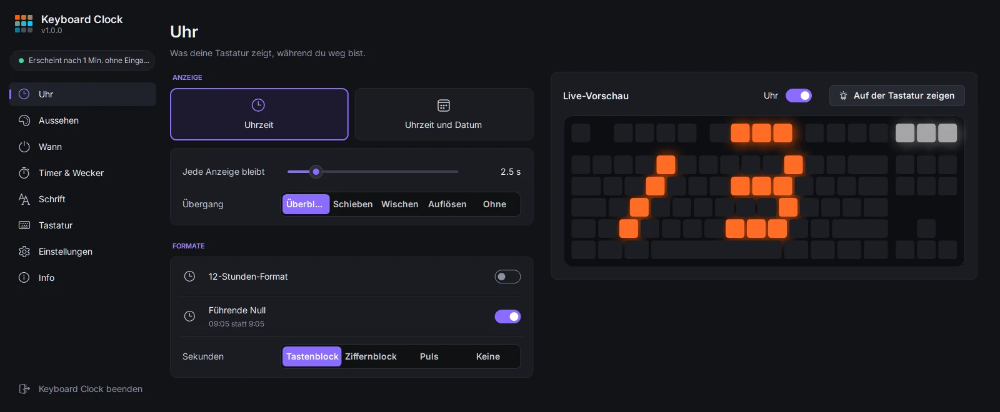
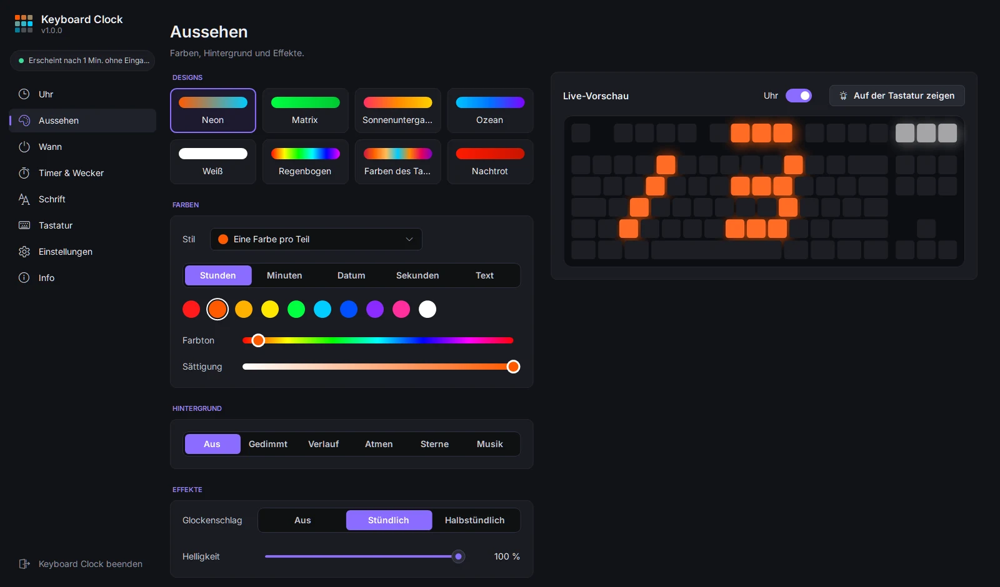
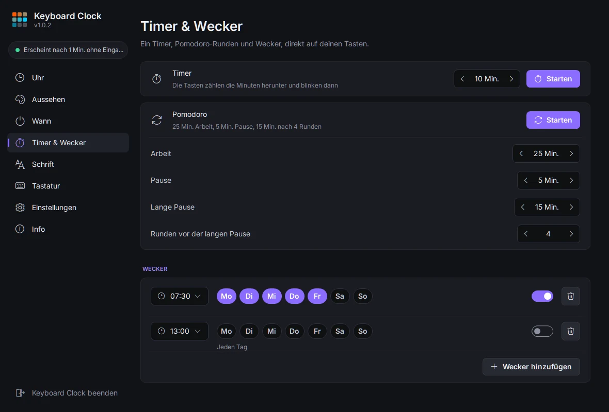
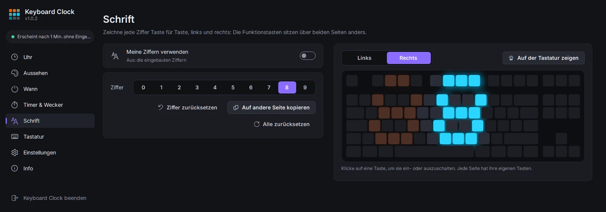

<p align="center">
  
</p>

<h1 align="center">Keyboard Clock</h1>

<p align="center">
  <b>Die Uhrzeit in großen Ziffern auf deiner RGB-Tastatur.</b><br>
  Eine kostenlose Open-Source-App für Windows, für Tastaturen von Logitech G, Razer, Corsair, ASUS, SteelSeries, HyperX und OpenRGB.
</p>

<p align="center">
  <a href="https://github.com/Ilyomix/keyboard-clock/releases/latest"></a>
  <a href="https://github.com/Ilyomix/keyboard-clock/releases"></a>
  <a href="https://github.com/Ilyomix/keyboard-clock/actions/workflows/ci.yml"></a>
  
  <a href="LICENSE"></a>
</p>

<p align="center">
  <a href="https://github.com/Ilyomix/keyboard-clock/releases/latest/download/KeyboardClockSetup.exe"><b>⬇ Für Windows herunterladen</b></a>
  &nbsp;·&nbsp; <a href="https://ilyomix.github.io/keyboard-clock/de/"><b>Website und Live-Demo</b></a>
</p>

<p align="center">
  <a href="README.md">English</a> · <a href="README.fr.md">Français</a> · <a href="README.es.md">Español</a> · <b>Deutsch</b> · <a href="README.it.md">Italiano</a> · <a href="README.pt.md">Português</a>
</p>

---

Geh vom PC weg, und **Keyboard Clock** macht deine Tastatur zu einer Uhr, die du noch vom anderen Ende des Raums
ablesen kannst. Erst leuchten die Stunden auf der linken Hälfte der Tasten, dann die Minuten auf der rechten, in
großen Ziffern, die Taste für Taste über F-Tasten, Zahlenreihe und Buchstaben gezeichnet sind. Die Sekunden füllen
die neun Tasten über den Pfeiltasten. Berühre die Maus oder eine beliebige Taste, und deine gewohnte Beleuchtung ist
sofort zurück.

Dazu kommen ein **Timer**, **Pomodoro**-Runden und **Wecker** direkt auf den Tasten, Licht im Takt deiner **Musik**
und die Möglichkeit, **eigene Ziffern zu zeichnen**.

## Funktionen

- **Große, gut lesbare Ziffern**: zwei Ziffern auf einmal, von Hand für echte Tastenkappen gezeichnet, auf TKL- und
  Full-Size-Tastaturen.
- **Erscheint, wenn du gehst**: nach einer Wartezeit deiner Wahl (10 Sekunden bis 30 Minuten), sobald du den PC
  sperrst (Win+L), dauerhaft oder per globalem Tastenkürzel (standardmäßig Strg+Alt+H).
- **Stört nicht**: ausgeblendet, solange ein Spiel oder Video im Vollbild läuft oder Apps deiner Wahl geöffnet sind.
  Schaltet die Tastatur auf Wunsch nach einer Weile aus.
- **Designs und Farben**: Neon, Sonnenuntergang, Ozean, Matrix, Regenbogen, Weiß, Nachtrot, Farben, die der
  Tageszeit folgen, oder deine eigenen Farben pro Element, Verläufe und Farben pro Ziffer.
- **Hintergründe**: aus, eine gedimmte Farbe, ein Verlauf, Atmen, funkelnde Sterne oder **Reaktion auf die Musik**,
  die dein PC abspielt (Puls oder Spektrum).
- **Übergänge**: Überblenden, Schieben, Wischen, Auflösen oder keiner, und auf Wunsch das Datum dazwischen.
- **Timer und Pomodoro**: Starte sie über das Symbol in der Taskleiste. Die Tastatur zeigt die verbleibenden Minuten
  und blinkt, wenn die Zeit um ist. Arbeit und Pausen bekommen eigene Farben.
- **Wecker und Erinnerungen**: eine Uhrzeit und Wochentage; die ganze Tastatur blinkt, bis du eine Taste drückst.
- **Schrifteditor**: Klicke auf Tasten, um jede Ziffer neu zu zeichnen, links und rechts, mit Live-Vorschau.
- **Nachtmodus und Stundenschlag**: nachts gedimmt, rot oder aus; zur vollen Stunde läuft eine Lichtwelle über die
  Tasten.
- **Eine echte App**: ein Symbol neben der Uhr mit Schnellpanel, ein Fenster mit Live-Vorschau deiner Tastatur,
  sechs Sprachen, startet mit Windows, Updates mit einem Klick.

## Screenshots

<p align="center">
  
</p>

| Aussehen | Timer und Wecker | Schrifteditor |
|---|---|---|
|  |  |  |

## Installation

1. Lade **[KeyboardClockSetup.exe](https://github.com/Ilyomix/keyboard-clock/releases/latest/download/KeyboardClockSetup.exe)**
   herunter (Windows 10 oder 11, 64 Bit, keine Administratorrechte nötig).
2. Führe die Datei aus. Falls Windows SmartScreen warnt, klicke auf **Weitere Informationen** und dann auf
   **Trotzdem ausführen**: Die App ist neu, deshalb kennt Microsoft sie noch nicht.
3. Lass deine Beleuchtungssoftware laufen:
   - **Logitech G**: Öffne in G HUB die *Einstellungen* und aktiviere
     **„Allow games & applications to control my lighting“**.
   - **Dynamische Beleuchtung von Windows**: Schalte unter *Einstellungen > Personalisierung > Dynamische
     Beleuchtung* die Dynamische Beleuchtung für diese Tastatur aus, damit Keyboard Clock und Windows nicht
     gleichzeitig die Tasten steuern.
   - **OpenRGB**: Starte OpenRGB mit eingeschaltetem SDK-Server (Tab *SDK Server*, *Start Server*).

Weitere Downloads, alle im [neuesten Release](https://github.com/Ilyomix/keyboard-clock/releases/latest):

| Datei | Was es ist |
|---|---|
| `KeyboardClockSetup.exe` | Das Installationsprogramm (Startmenü, startet mit Windows, saubere Deinstallation) |
| `KeyboardClockPortable.exe` | Eine Datei, keine Installation |
| `keyboard-clock.exe` | Kommandozeile, für Skripte |
| `keyboard_clock.py` | Die ganze App in einer Python-Datei (Python 3.9+, keine Abhängigkeiten) |
| `SHA256SUMS.txt` | Prüfsummen aller Dateien |

Jedes Release wird von [GitHub Actions](.github/workflows/release.yml) aus diesem Quellcode gebaut, getestet
(Installation und Deinstallation inklusive) und mit SHA-256-Prüfsummen veröffentlicht.

## Welche Tastaturen funktionieren?

Jede Tastatur mit **RGB-Beleuchtung pro Taste**, die eine dieser Lösungen steuern kann. Die Tasten werden über ihre
Position erkannt, das Layout spielt also keine Rolle: AZERTY, QWERTY, QWERTZ, ISO oder ANSI.

| | Über | Status |
|---|---|---|
| **Logitech G** (G PRO, G PRO X, G915, G815, G513, G512…) | LED SDK von G HUB | Getestet mit einer G PRO TKL |
| **Razer, Corsair, ASUS ROG, SteelSeries, HyperX, Logitech** und andere | Dynamische Beleuchtung von Windows (HID LampArray) | Beta |
| Von **OpenRGB** unterstützte Tastaturen | SDK-Server von OpenRGB | Beta |

Nicht unterstützt: Tastaturen, die nur in Zonen oder Reihen leuchten, 60- und 65-%-Tastaturen (keine F-Tasten-Reihe
zum Zeichnen), macOS und Linux. Deine Tastatur funktioniert, oder eben nicht?
[Schreib es mir in einem Issue](https://github.com/Ilyomix/keyboard-clock/issues/new/choose): Das hilft allen mit
demselben Modell.

## FAQ

**Wie zeige ich die Uhrzeit auf meiner RGB-Tastatur an?**
Installiere Keyboard Clock und lass deinen PC eine Minute lang in Ruhe: Die Uhrzeit erscheint in großen Ziffern auf
den Tasten. Du kannst sie auch anzeigen lassen, sobald du den PC sperrst, dauerhaft oder per Tastenkürzel.

**Auf meiner Logitech-Tastatur erscheint nichts.**
Aktiviere in G HUB unter *Einstellungen* die Option *„Allow games & applications to control my lighting“* und lass
G HUB laufen. Klicke dann im Fenster von Keyboard Clock auf *Auf der Tastatur zeigen*.

**Funktioniert Keyboard Clock mit Razer Synapse, Corsair iCUE oder SteelSeries GG?**
Nicht direkt, sondern über Windows: Für diese Marken nutzt Keyboard Clock die Dynamische Beleuchtung von Windows
(Windows 11) oder OpenRGB. Wird deine Tastatur unter *Einstellungen > Personalisierung > Dynamische Beleuchtung*
aufgeführt, kann sie die Uhr anzeigen.

**Bremst Keyboard Clock meine Spiele aus?**
Nein. Solange ein Spiel im Vollbild läuft, bleibt die App ausgeblendet, und ein Frame zu zeichnen dauert nur den
Bruchteil einer Millisekunde.

**Verändert Keyboard Clock meine Beleuchtung dauerhaft?**
Nein. Sobald du Maus oder Tastatur berührst, ist deine gewohnte Beleuchtung zurück.

**Sammelt Keyboard Clock Daten?**
Kein Konto, keine Werbung, keine Telemetrie. Die App sucht nur einmal am Tag auf GitHub nach einer neuen Version, und
das kannst du abschalten. Siehe die [Datenschutzerklärung](PRIVACY.md).

## Kommandozeile

```bash
keyboard-clock --demo                 # every look on the keyboard, then exit
keyboard-clock --theme sunset --delay 10
keyboard-clock --stop                 # stop the clock running in the background
keyboard-clock --help                 # all the options
```

## Aus dem Quellcode bauen

```bash
git clone https://github.com/Ilyomix/keyboard-clock
cd keyboard-clock
python keyboard_clock.py              # run the app (Python 3.9+, Windows, no dependencies)
python -m unittest discover tests     # the tests
pip install pyinstaller && pyinstaller --onefile --noconsole --name KeyboardClock keyboard_clock.py
```

Die Website, die Bilder im README und die Screenshots werden von [`tools/build.py`](tools/build.py) aus der App
selbst erzeugt.

## So funktioniert’s

Keyboard Clock ist eine einzige Python-Datei, die nur die Standardbibliothek und `ctypes` nutzt. Jeder Frame wird in
Ebenen gezeichnet (Hintergrund, Ziffern, Sekunden, Effekte, Helligkeit und Nachtmodus, Gammakorrektur) und dann an
die Tastatur gesendet:

- **Logitech**: über das LED SDK, das G HUB installiert, Taste für Taste.
- **Dynamische Beleuchtung von Windows**: direkt an die Tastatur über HID LampArray, den Standard hinter der
  Dynamischen Beleuchtung; die Tasten werden über die Tastenzuordnung jeder Lampe gefunden.
- **OpenRGB**: über den SDK-Server von OpenRGB auf deinem PC; die LED-Namen werden den Tasten zugeordnet.

Wenn Keyboard Clock stoppt, gibt es die Beleuchtung an deine Software zurück.

## Auch von mir

[**Glowback**](https://github.com/Ilyomix/glowback): Umgebungslicht für die RGB-LEDs hinter deinem Monitor, in
Echtzeit synchron zu deinem Bildschirm.

## Lizenz

[MIT](LICENSE). Logitech, Logitech G und G HUB sind Marken von Logitech. Razer, Corsair, ASUS, SteelSeries, HyperX
und Windows sind Marken ihrer jeweiligen Inhaber. Keyboard Clock ist ein unabhängiges Projekt, steht in keiner
Verbindung zu diesen Unternehmen und wird von keinem von ihnen unterstützt oder empfohlen. Das Fenster verwendet die
Schriftart Inter (SIL Open Font License, [licenses/Inter-OFL.txt](licenses/Inter-OFL.txt)).
