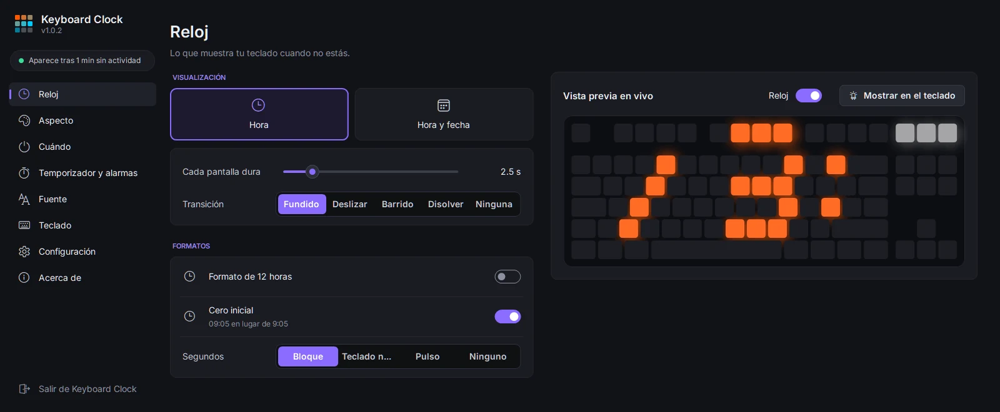
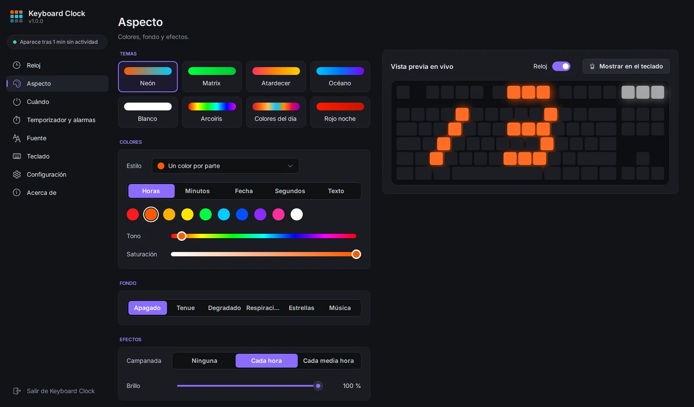
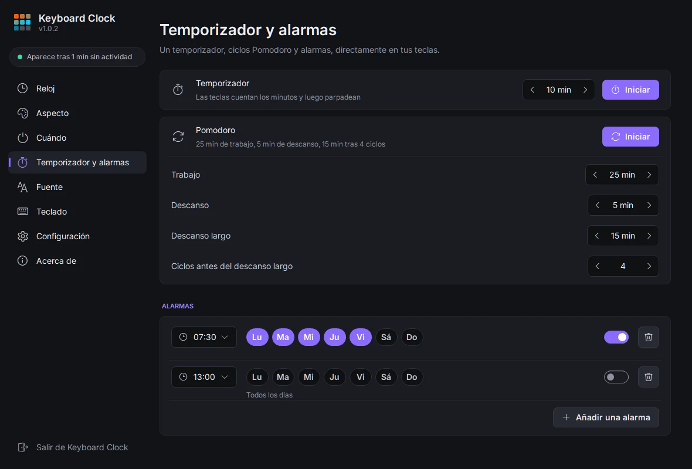
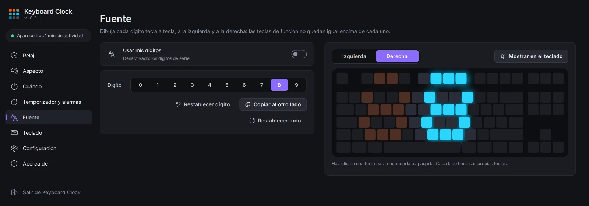

<p align="center">
  
</p>

<h1 align="center">Keyboard Clock</h1>

<p align="center">
  <b>La hora, en grande, en tu teclado RGB.</b><br>
  Una app gratuita y de código abierto para Windows, para teclados Logitech G, Razer, Corsair, ASUS, SteelSeries, HyperX y OpenRGB.
</p>

<p align="center">
  <a href="https://github.com/Ilyomix/keyboard-clock/releases/latest"></a>
  <a href="https://github.com/Ilyomix/keyboard-clock/releases"></a>
  <a href="https://github.com/Ilyomix/keyboard-clock/actions/workflows/ci.yml"></a>
  
  <a href="LICENSE"></a>
</p>

<p align="center">
  <a href="https://github.com/Ilyomix/keyboard-clock/releases/latest/download/KeyboardClockSetup.exe"><b>⬇ Descargar para Windows</b></a>
  &nbsp;·&nbsp; <a href="https://ilyomix.github.io/keyboard-clock/es/"><b>Sitio web y demo en vivo</b></a>
</p>

<p align="center">
  <a href="README.md">English</a> · <a href="README.fr.md">Français</a> · <b>Español</b> · <a href="README.de.md">Deutsch</a> · <a href="README.it.md">Italiano</a> · <a href="README.pt.md">Português</a>
</p>

---

Deja tu PC y **Keyboard Clock** convierte tu teclado en un reloj que puedes leer desde la otra punta de la habitación.
Primero las horas y luego los minutos, en dos grandes dígitos
dibujados tecla a tecla sobre las teclas de función, la fila de números y las letras, un dígito en cada mitad del teclado. Los segundos llenan las nueve
teclas sobre las flechas. Toca el ratón o cualquier tecla y tu iluminación de siempre vuelve al instante.

También ejecuta un **temporizador**, ciclos **Pomodoro** y **alarmas** directamente en las teclas, se ilumina con tu
**música** y te permite **dibujar tus propios dígitos**.

## Funciones

- **Dígitos grandes y legibles**: dos dígitos a la vez, dibujados a mano para teclas reales, en teclados TKL y de
  tamaño completo.
- **Aparece cuando te vas**: tras el tiempo que elijas (de 10 segundos a 30 minutos), en cuanto bloqueas tu PC
  (Win+L), siempre o con un atajo global (Ctrl+Alt+H por defecto).
- **No estorba**: se oculta mientras un juego o un vídeo está en pantalla completa, o mientras se ejecutan las apps
  que elijas. Si quieres, apaga el teclado al cabo de un rato.
- **Temas y colores**: Neón, Atardecer, Océano, Matrix, Arcoíris, Blanco, Rojo noche, colores que siguen la hora del
  día, o tus propios colores por elemento, degradados y colores por dígito.
- **Fondos**: apagado, un color tenue, un degradado, respiración, estrellas titilantes o **al ritmo de la música** que
  suena en tu PC (pulso o espectro).
- **Transiciones**: fundido, deslizamiento, barrido, disolución o ninguna, y la fecha intercalada si la quieres.
- **Temporizador y Pomodoro**: inícialos desde el icono de la barra de tareas. El teclado muestra los minutos que
  quedan y parpadea cuando se acaba el tiempo. El trabajo y los descansos tienen sus propios colores.
- **Alarmas y recordatorios**: una hora y unos días de la semana; todo el teclado parpadea hasta que pulses una tecla.
- **Editor de fuente**: haz clic en las teclas para redibujar cualquier dígito, en el lado izquierdo y en el derecho,
  con vista previa en vivo.
- **Modo noche y campanada horaria**: atenuado, en rojo o apagado por la noche; a cada hora en punto, una ola de luz
  recorre las teclas.
- **Una app de verdad**: un icono junto al reloj con un panel rápido, una ventana con vista previa en vivo de tu
  teclado, seis idiomas, se inicia con Windows y se actualiza con un clic.

## Capturas de pantalla

<p align="center">
  
</p>

| Aspecto | Temporizador y alarmas | Editor de fuente |
|---|---|---|
|  |  |  |

## Instalación

1. Descarga **[KeyboardClockSetup.exe](https://github.com/Ilyomix/keyboard-clock/releases/latest/download/KeyboardClockSetup.exe)**
   (Windows 10 u 11, de 64 bits, sin permisos de administrador).
2. Ejecútalo. Si Windows SmartScreen te muestra un aviso, haz clic en **Más información** y luego en **Ejecutar de
   todas formas**: la app es nueva y Microsoft todavía no la conoce.
3. Mantén abierto tu software de iluminación:
   - **Logitech G**: abre G HUB, *Configuración*, y activa **«Allow games & applications to control my lighting»**.
   - **Iluminación dinámica de Windows**: en *Configuración > Personalización > Iluminación dinámica*, desactiva la
     Iluminación dinámica para ese teclado, para que Keyboard Clock y Windows no controlen las teclas a la vez.
   - **OpenRGB**: inicia OpenRGB con su servidor SDK activado (pestaña *SDK Server*, *Start Server*).

Otras descargas, todas en la [última versión](https://github.com/Ilyomix/keyboard-clock/releases/latest):

| Archivo | Qué es |
|---|---|
| `KeyboardClockSetup.exe` | El instalador (menú Inicio, se inicia con Windows, desinstalación limpia) |
| `KeyboardClockPortable.exe` | Un solo archivo, sin instalar nada |
| `keyboard-clock.exe` | Línea de comandos, para scripts |
| `keyboard_clock.py` | Toda la app en un solo archivo de Python (Python 3.9+, sin dependencias) |
| `SHA256SUMS.txt` | Sumas de verificación de todos los archivos |

[GitHub Actions](.github/workflows/release.yml) compila cada versión a partir de este código fuente, la prueba
(instalación y desinstalación incluidas) y la publica con sumas de verificación SHA-256.

## ¿Qué teclados son compatibles?

Cualquier teclado con **RGB por tecla** que pueda controlar alguno de estos. Las teclas se localizan por su posición,
así que la distribución da igual: AZERTY, QWERTY, QWERTZ, ISO o ANSI.

| | A través de | Estado |
|---|---|---|
| **Logitech G** (G PRO, G PRO X, G915, G815, G513, G512…) | El LED SDK de G HUB | Probado en un G PRO TKL |
| **Razer, Corsair, ASUS ROG, SteelSeries, HyperX, Logitech** y otros | Iluminación dinámica de Windows (HID LampArray) | Beta |
| Teclados compatibles con **OpenRGB** | El servidor SDK de OpenRGB | Beta |

No compatibles: teclados iluminados solo por zonas o por filas, teclados 60% y 65% (sin fila de teclas de función
donde dibujar), macOS y Linux. ¿Tu teclado funciona, o no? [Cuéntamelo en un issue](https://github.com/Ilyomix/keyboard-clock/issues/new/choose):
ayuda a todos los que tienen el mismo modelo.

## Preguntas frecuentes

**¿Cómo muestro la hora en mi teclado RGB?**
Instala Keyboard Clock y no toques tu PC durante un minuto: la hora aparece en grande sobre las teclas. También
puedes mostrarla en cuanto bloqueas tu PC, todo el tiempo o con un atajo de teclado.

**No aparece nada en mi teclado Logitech.**
En G HUB, *Configuración*, activa *«Allow games & applications to control my lighting»* y deja G HUB abierto.
Después, haz clic en *Mostrar en el teclado* en la ventana de Keyboard Clock.

**¿Funciona con Razer Synapse, Corsair iCUE o SteelSeries GG?**
No directamente, sino a través de Windows: para estas marcas, Keyboard Clock usa la Iluminación dinámica de Windows
(Windows 11) u OpenRGB. Si tu teclado aparece en *Configuración > Personalización > Iluminación dinámica*, puede
mostrar el reloj.

**¿Ralentiza mis juegos?**
No. Se mantiene oculto mientras un juego está en pantalla completa, y dibujar un fotograma lleva una fracción de
milisegundo.

**¿Cambia mi iluminación para siempre?**
No. En cuanto tocas el ratón o el teclado, vuelve tu iluminación de siempre.

**¿Recopila datos?**
Sin cuenta, sin anuncios, sin telemetría. Solo consulta GitHub una vez al día para buscar una versión nueva, y puedes
desactivarlo. Consulta la [política de privacidad](PRIVACY.md).

## Línea de comandos

```bash
keyboard-clock --demo                 # todos los estilos en el teclado y luego se cierra
keyboard-clock --theme sunset --delay 10
keyboard-clock --stop                 # detiene el reloj que funciona en segundo plano
keyboard-clock --help                 # todas las opciones
```

## Compilar desde el código fuente

```bash
git clone https://github.com/Ilyomix/keyboard-clock
cd keyboard-clock
python keyboard_clock.py              # ejecuta la app (Python 3.9+, Windows, sin dependencias)
python -m unittest discover tests     # las pruebas
pip install pyinstaller && pyinstaller --onefile --noconsole --name KeyboardClock keyboard_clock.py
```

El sitio web, las imágenes del README y las capturas de pantalla se generan a partir de la propia app con
[`tools/build.py`](tools/build.py).

## Cómo funciona

Keyboard Clock es un único archivo de Python que solo usa la biblioteca estándar y `ctypes`. Cada fotograma se
dibuja por capas (fondo, dígitos, segundos, efectos, brillo y modo noche, corrección gamma) y luego se envía al
teclado:

- **Logitech**: a través del LED SDK que instala G HUB, tecla a tecla.
- **Iluminación dinámica de Windows**: directamente al teclado mediante HID LampArray, el estándar en el que se basa
  la Iluminación dinámica, usando la tecla asociada a cada lámpara para localizar las teclas.
- **OpenRGB**: a través de su servidor SDK en tu PC, asociando los nombres de los LED con las teclas.

Cuando se detiene, devuelve el control de la iluminación a tu software.

## Otros proyectos míos

[**Glowback**](https://github.com/Ilyomix/glowback): luz ambiental con los LED RGB de detrás de tu monitor,
sincronizada con tu pantalla en tiempo real.

## Licencia

[MIT](LICENSE). Logitech, Logitech G y G HUB son marcas comerciales de Logitech. Razer, Corsair, ASUS, SteelSeries,
HyperX y Windows son marcas comerciales de sus respectivos propietarios. Keyboard Clock es un proyecto independiente,
sin afiliación ni respaldo de ninguno de ellos. La ventana usa la fuente Inter (SIL Open Font License,
[licenses/Inter-OFL.txt](licenses/Inter-OFL.txt)).
