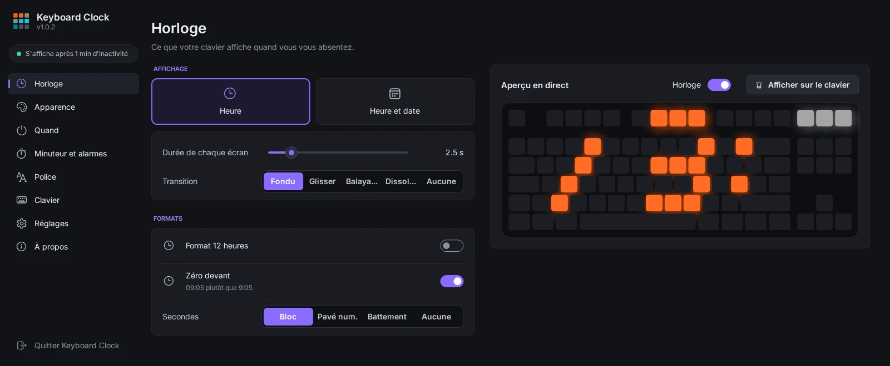
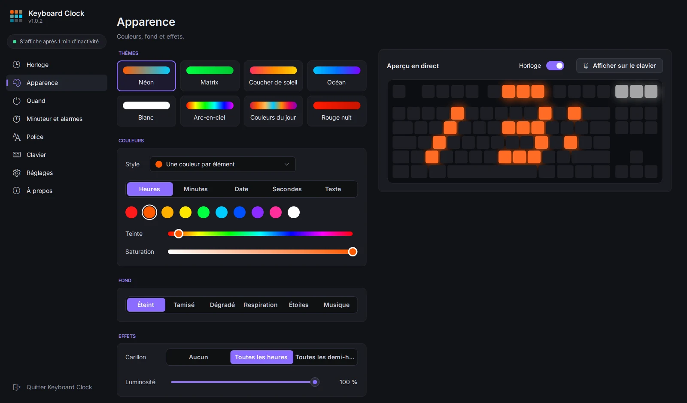
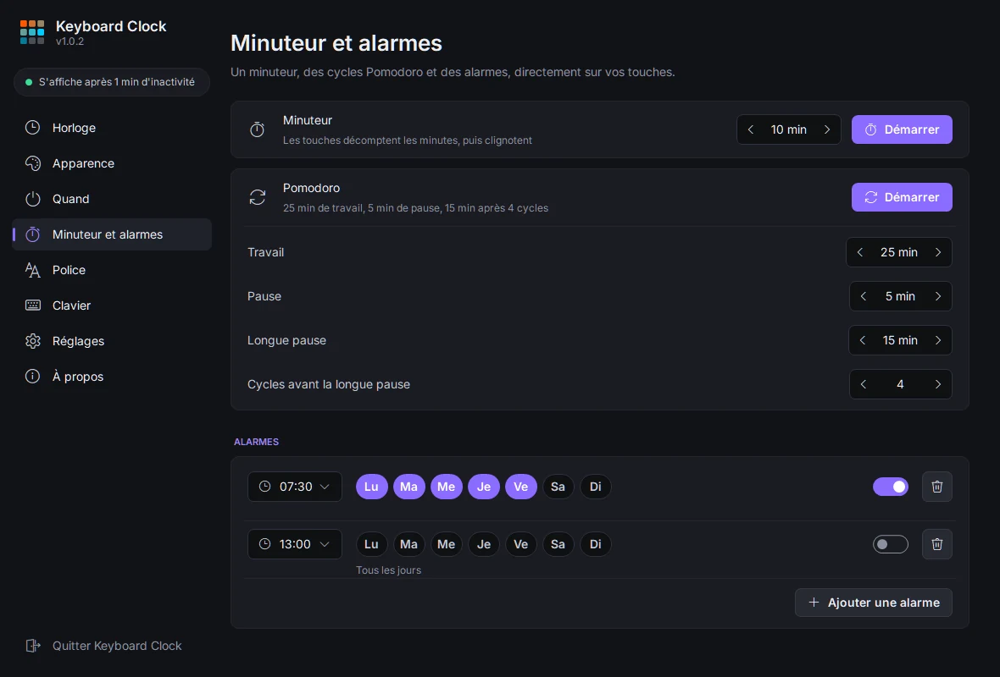
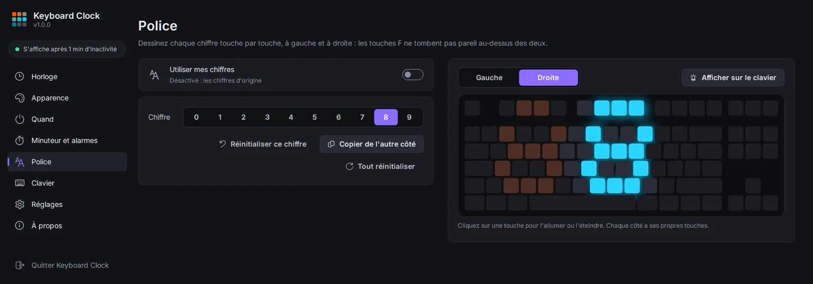

<p align="center">
  
</p>

<h1 align="center">Keyboard Clock</h1>

<p align="center">
  <b>L'heure, en gros chiffres, sur votre clavier RGB.</b><br>
  Un logiciel Windows gratuit et open source pour les claviers Logitech G, Razer, Corsair, ASUS, SteelSeries, HyperX et OpenRGB.
</p>

<p align="center">
  <a href="https://github.com/Ilyomix/keyboard-clock/releases/latest"></a>
  <a href="https://github.com/Ilyomix/keyboard-clock/releases"></a>
  <a href="https://github.com/Ilyomix/keyboard-clock/actions/workflows/ci.yml"></a>
  
  <a href="LICENSE"></a>
</p>

<p align="center">
  <a href="https://github.com/Ilyomix/keyboard-clock/releases/latest/download/KeyboardClockSetup.exe"><b>⬇ Télécharger pour Windows</b></a>
  &nbsp;·&nbsp; <a href="https://ilyomix.github.io/keyboard-clock/fr/"><b>Site web et démo en direct</b></a>
</p>

<p align="center">
  <a href="README.md">English</a> · <b>Français</b> · <a href="README.es.md">Español</a> · <a href="README.de.md">Deutsch</a> · <a href="README.it.md">Italiano</a> · <a href="README.pt.md">Português</a>
</p>

---

Éloignez-vous de votre PC : **Keyboard Clock** transforme votre clavier en horloge lisible depuis l'autre bout de la
pièce. D'abord les heures, puis les minutes, en deux gros chiffres
dessinés touche par touche sur les touches F, la rangée des chiffres et les lettres, un chiffre sur chaque moitié du clavier. Les secondes remplissent les neuf
touches au-dessus des flèches. Touchez la souris ou une touche, et votre éclairage habituel revient aussitôt.

Il gère aussi un **minuteur**, des cycles **Pomodoro** et des **alarmes** directement sur les touches, s'anime au
rythme de votre **musique** et vous permet de **dessiner vos propres chiffres**.

## Fonctionnalités

- **De gros chiffres lisibles** : deux chiffres à la fois, dessinés à la main pour de vraies touches, sur les claviers
  TKL et format complet.
- **S'affiche quand vous partez** : après le délai de votre choix (de 10 secondes à 30 minutes), dès que vous
  verrouillez le PC (Win+L), en permanence, ou avec un raccourci global (Ctrl+Alt+H par défaut).
- **Discret** : masqué quand un jeu ou une vidéo est en plein écran, ou quand des applications de votre choix sont
  ouvertes. Peut éteindre le clavier au bout d'un moment si vous le souhaitez.
- **Thèmes et couleurs** : Néon, Coucher de soleil, Océan, Matrix, Arc-en-ciel, Blanc, Rouge nuit, des couleurs qui
  suivent le moment de la journée, ou vos propres couleurs par élément, des dégradés et une couleur par chiffre.
- **Fonds** : éteint, une couleur tamisée, un dégradé, une respiration, des étoiles scintillantes, ou un fond qui
  **réagit à la musique** de votre PC (pulsation ou spectre).
- **Transitions** : fondu, glissement, balayage, dissolution ou aucune, et la date en alternance si vous le voulez.
- **Minuteur et Pomodoro** : lancez-les depuis l'icône de la barre des tâches. Le clavier affiche les minutes
  restantes, puis clignote quand le temps est écoulé. Le travail et les pauses ont leurs propres couleurs.
- **Alarmes et rappels** : une heure et des jours de la semaine ; tout le clavier clignote jusqu'à ce que vous
  appuyiez sur une touche.
- **Éditeur de police** : cliquez sur les touches pour redessiner n'importe quel chiffre, côté gauche et côté droit,
  avec un aperçu en direct.
- **Mode nuit et carillon horaire** : touches tamisées, en rouge ou éteintes la nuit ; une vague de lumière balaie
  les touches à chaque heure pile.
- **Une vraie application** : une icône près de l'horloge avec un panneau rapide, une fenêtre avec un aperçu en
  direct de votre clavier, six langues, démarrage avec Windows, mises à jour en un clic.

## Captures d'écran

<p align="center">
  
</p>

| Apparence | Minuteur et alarmes | Éditeur de police |
|---|---|---|
|  |  |  |

## Installation

1. Téléchargez **[KeyboardClockSetup.exe](https://github.com/Ilyomix/keyboard-clock/releases/latest/download/KeyboardClockSetup.exe)**
   (Windows 10 ou 11, 64 bits, sans droits d'administrateur).
2. Lancez-le. Si Windows SmartScreen affiche un avertissement, cliquez sur **Informations complémentaires**, puis sur
   **Exécuter quand même** : le logiciel est récent, Microsoft ne le connaît pas encore.
3. Laissez votre logiciel d'éclairage ouvert :
   - **Logitech G** : ouvrez G HUB, *Paramètres*, et activez **Autoriser les jeux et les applications à contrôler mon
     éclairage**.
   - **Éclairage dynamique de Windows** : dans *Paramètres > Personnalisation > Éclairage dynamique*, désactivez
     l'Éclairage dynamique pour ce clavier, pour que Keyboard Clock et Windows ne pilotent pas les touches en même
     temps.
   - **OpenRGB** : lancez OpenRGB avec son serveur SDK activé (onglet *SDK Server*, *Start Server*).

Autres téléchargements, tous dans la [dernière version](https://github.com/Ilyomix/keyboard-clock/releases/latest) :

| Fichier | Description |
|---|---|
| `KeyboardClockSetup.exe` | L'installateur (menu Démarrer, démarrage avec Windows, désinstallation propre) |
| `KeyboardClockPortable.exe` | Un seul fichier, rien à installer |
| `keyboard-clock.exe` | Ligne de commande, pour les scripts |
| `keyboard_clock.py` | Tout le logiciel en un seul fichier Python (Python 3.9+, sans dépendances) |
| `SHA256SUMS.txt` | Les sommes de contrôle de chaque fichier |

Chaque version est compilée par [GitHub Actions](.github/workflows/release.yml) à partir de ce code source, testée
(installation et désinstallation comprises) et publiée avec ses sommes de contrôle SHA-256.

## Quels claviers sont compatibles ?

Tout clavier à **éclairage RGB par touche** que l'un de ces logiciels sait piloter. Les touches sont repérées par leur
position, la disposition n'a donc pas d'importance : AZERTY, QWERTY, QWERTZ, ISO ou ANSI.

| | Via | État |
|---|---|---|
| **Logitech G** (G PRO, G PRO X, G915, G815, G513, G512…) | Le SDK LED de G HUB | Testé sur un G PRO TKL |
| **Razer, Corsair, ASUS ROG, SteelSeries, HyperX, Logitech** et d'autres | Éclairage dynamique de Windows (HID LampArray) | Bêta |
| Claviers pris en charge par **OpenRGB** | Le serveur SDK d'OpenRGB | Bêta |

Non pris en charge : les claviers éclairés uniquement par zones ou par rangées, les claviers 60 % et 65 % (pas de
rangée de touches F où dessiner), macOS et Linux. Votre clavier fonctionne, ou pas ?
[Dites-le-moi dans une issue](https://github.com/Ilyomix/keyboard-clock/issues/new/choose) : cela aide tous ceux qui
ont le même modèle.

## FAQ

**Comment afficher l'heure sur mon clavier RGB ?**
Installez Keyboard Clock et laissez votre PC tranquille une minute : l'heure apparaît sur les touches en gros
chiffres. Vous pouvez aussi l'afficher dès que vous verrouillez le PC, en permanence ou avec un raccourci clavier.

**Rien ne s'affiche sur mon clavier Logitech.**
Dans G HUB, *Paramètres*, activez *Autoriser les jeux et les applications à contrôler mon éclairage*, et laissez
G HUB ouvert. Cliquez ensuite sur *Afficher sur le clavier* dans la fenêtre de Keyboard Clock.

**Est-ce compatible avec Razer Synapse, Corsair iCUE ou SteelSeries GG ?**
Pas directement : pour ces marques, Keyboard Clock passe par l'Éclairage dynamique de Windows (Windows 11) ou par
OpenRGB. Si votre clavier figure dans *Paramètres > Personnalisation > Éclairage dynamique*, il peut afficher
l'horloge.

**Est-ce que ça ralentit mes jeux ?**
Non. L'horloge reste masquée quand un jeu est en plein écran, et dessiner une image prend une fraction de
milliseconde.

**Est-ce que ça modifie définitivement mon éclairage ?**
Non. Dès que vous touchez la souris ou le clavier, votre éclairage habituel revient.

**Est-ce que des données sont collectées ?**
Ni compte, ni publicité, ni télémétrie. Le logiciel vérifie seulement une fois par jour sur GitHub si une nouvelle
version existe, ce que vous pouvez désactiver. Voir la [politique de confidentialité](PRIVACY.md).

## Ligne de commande

```bash
keyboard-clock --demo                 # every look on the keyboard, then exit
keyboard-clock --theme sunset --delay 10
keyboard-clock --stop                 # stop the clock running in the background
keyboard-clock --help                 # all the options
```

## Compiler depuis les sources

```bash
git clone https://github.com/Ilyomix/keyboard-clock
cd keyboard-clock
python keyboard_clock.py              # run the app (Python 3.9+, Windows, no dependencies)
python -m unittest discover tests     # the tests
pip install pyinstaller && pyinstaller --onefile --noconsole --name KeyboardClock keyboard_clock.py
```

Le site web, les images du README et les captures d'écran sont générés à partir du logiciel lui-même par
[`tools/build.py`](tools/build.py).

## Comment ça marche

Keyboard Clock tient en un seul fichier Python qui n'utilise que la bibliothèque standard et `ctypes`. Chaque image
est dessinée en couches (fond, chiffres, secondes, effets, luminosité et mode nuit, correction gamma), puis envoyée
au clavier :

- **Logitech** : via le SDK LED qu'installe G HUB, touche par touche.
- **Éclairage dynamique de Windows** : directement au clavier en HID LampArray, la norme sur laquelle repose
  l'Éclairage dynamique, en s'appuyant sur la touche associée à chaque LED pour trouver les touches.
- **OpenRGB** : via son serveur SDK sur votre PC, en faisant correspondre les noms des LED aux touches.

Quand il s'arrête, il rend la main à votre logiciel d'éclairage.

## Du même auteur

[**Glowback**](https://github.com/Ilyomix/glowback) : un éclairage d'ambiance pour les LED RGB placées derrière votre
écran, synchronisé en temps réel avec ce qu'il affiche.

## Licence

[MIT](LICENSE). Logitech, Logitech G et G HUB sont des marques de Logitech. Razer, Corsair, ASUS, SteelSeries,
HyperX et Windows sont des marques de leurs propriétaires respectifs. Keyboard Clock est un projet indépendant, qui
n'est ni affilié à ces sociétés ni approuvé par elles. La fenêtre utilise la police Inter (SIL Open Font License,
[licenses/Inter-OFL.txt](licenses/Inter-OFL.txt)).
