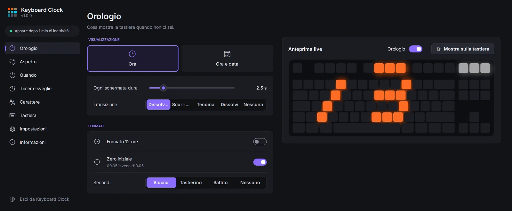
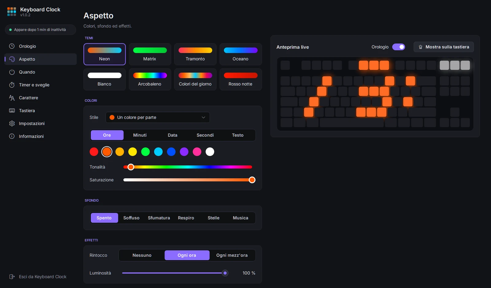
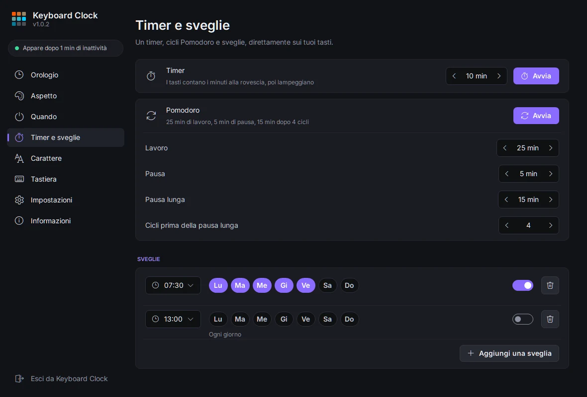
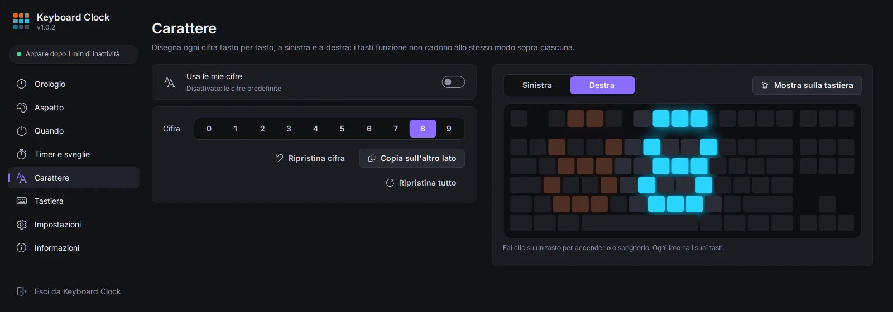

<p align="center">
  
</p>

<h1 align="center">Keyboard Clock</h1>

<p align="center">
  <b>L'ora, a grandi cifre, sulla tua tastiera RGB.</b><br>
  Un'app per Windows gratuita e open source per tastiere Logitech G, Razer, Corsair, ASUS, SteelSeries, HyperX e OpenRGB.
</p>

<p align="center">
  <a href="https://github.com/Ilyomix/keyboard-clock/releases/latest"></a>
  <a href="https://github.com/Ilyomix/keyboard-clock/releases"></a>
  <a href="https://github.com/Ilyomix/keyboard-clock/actions/workflows/ci.yml"></a>
  
  <a href="LICENSE"></a>
</p>

<p align="center">
  <a href="https://apps.microsoft.com/detail/9N5M0SCJNPZ3"></a>
</p>

<p align="center">
  <a href="https://github.com/Ilyomix/keyboard-clock/releases/latest/download/KeyboardClockSetup.exe"><b>⬇ Scarica per Windows</b></a>
  &nbsp;·&nbsp; <a href="https://ilyomix.github.io/keyboard-clock/it/"><b>Sito web e demo dal vivo</b></a>
</p>

<p align="center">
  <a href="README.md">English</a> · <a href="README.fr.md">Français</a> · <a href="README.es.md">Español</a> · <a href="README.de.md">Deutsch</a> · <b>Italiano</b> · <a href="README.pt.md">Português</a>
</p>

---

Allontanati dal PC e **Keyboard Clock** trasforma la tua tastiera in un orologio che leggi dall'altra parte della stanza.
Prima le ore, poi i minuti, in due grandi cifre disegnate tasto per
tasto sui tasti funzione, sulla fila dei numeri e sulle lettere, una cifra su ogni metà della tastiera. I secondi riempiono i nove tasti sopra le frecce. Tocca
il mouse o un tasto qualsiasi e la tua illuminazione di sempre torna subito.

Gestisce anche un **timer**, cicli **Pomodoro** e **sveglie** direttamente sui tasti, si accende con la tua **musica** e
ti permette di **disegnare le tue cifre**.

## Funzionalità

- **Cifre grandi e leggibili**: due cifre alla volta, disegnate a mano per veri tasti, su tastiere TKL e full size.
- **Appare quando ti allontani**: dopo un ritardo a tua scelta (da 10 secondi a 30 minuti), appena blocchi il PC
  (Win+L), sempre, oppure con una scorciatoia globale (Ctrl+Alt+H di default).
- **Non dà fastidio**: resta nascosto quando un gioco o un video è a schermo intero, o mentre sono aperte le app che
  scegli tu. Se vuoi, dopo un po' spegne la tastiera.
- **Temi e colori**: Neon, Tramonto, Oceano, Matrix, Arcobaleno, Bianco, Rosso notte, colori che seguono l'ora del
  giorno, oppure i tuoi colori per ogni elemento, sfumature e un colore per ogni cifra.
- **Sfondi**: spento, un colore soffuso, una sfumatura, effetto respiro, stelle che brillano, oppure **a ritmo della
  musica** che il PC sta riproducendo (pulsazione o spettro).
- **Transizioni**: dissolvenza, scorrimento, tendina, dissolvi o nessuna, e la data in mezzo se la vuoi.
- **Timer e Pomodoro**: avviali dall'icona nella barra delle applicazioni. La tastiera mostra i minuti rimanenti, poi
  lampeggia allo scadere del tempo. Lavoro e pause hanno colori propri.
- **Sveglie e promemoria**: un orario e i giorni della settimana; tutta la tastiera lampeggia finché non premi un tasto.
- **Editor del carattere**: fai clic sui tasti per ridisegnare qualsiasi cifra, lato sinistro e lato destro, con
  anteprima dal vivo.
- **Modalità notte e rintocco orario**: di notte tasti attenuati, rossi o spenti; allo scoccare dell'ora un'onda di luce
  attraversa i tasti.
- **Una vera app**: un'icona accanto all'orologio con un pannello rapido, una finestra con l'anteprima dal vivo della
  tastiera, sei lingue, avvio con Windows, aggiornamenti in un clic.

## Screenshot

<p align="center">
  
</p>

| Aspetto | Timer e sveglie | Editor del carattere |
|---|---|---|
|  |  |  |

## Installazione

1. Installa Keyboard Clock da **[Microsoft Store](https://apps.microsoft.com/detail/9N5M0SCJNPZ3)**: Windows lo installa e lo tiene aggiornato. Oppure scarica **[KeyboardClockSetup.exe](https://github.com/Ilyomix/keyboard-clock/releases/latest/download/KeyboardClockSetup.exe)**
   (Windows 10 o 11, 64 bit, non servono diritti di amministratore).
2. Con l'installer: avvialo. Se Windows SmartScreen ti avvisa, fai clic su **Ulteriori informazioni**, poi su **Esegui comunque**: l'app
   è nuova, quindi Microsoft non la conosce ancora.
3. Lascia in esecuzione il tuo software di illuminazione:
   - **Logitech G**: apri G HUB, *Impostazioni*, e attiva **Allow games & applications to control my lighting**.
   - **Illuminazione dinamica di Windows**: in *Impostazioni > Personalizzazione > Illuminazione dinamica*, disattiva
     l'Illuminazione dinamica per quella tastiera, così Keyboard Clock e Windows non comandano i tasti
     contemporaneamente.
   - **OpenRGB**: avvia OpenRGB con il suo server SDK attivo (scheda *SDK Server*, *Start Server*).

Altri download, tutti nell'[ultima versione](https://github.com/Ilyomix/keyboard-clock/releases/latest):

| File | Cos'è |
|---|---|
| `KeyboardClockSetup.exe` | Il programma di installazione (menu Start, avvio con Windows, disinstallazione pulita) |
| `KeyboardClockPortable.exe` | Un solo file, niente da installare |
| `keyboard-clock.exe` | Riga di comando, per gli script |
| `keyboard_clock.py` | L'intera app in un solo file Python (Python 3.9+, nessuna dipendenza) |
| `SHA256SUMS.txt` | I checksum di ogni file |

Ogni versione è compilata da [GitHub Actions](.github/workflows/release.yml) a partire da questo codice sorgente, testata
(installazione e disinstallazione comprese) e pubblicata con checksum SHA-256.

> **Firma del codice**: Keyboard Clock sta richiedendo la firma del codice gratuita di [SignPath Foundation](https://signpath.org/) per i progetti open source; i file per Windows saranno firmati così appena il progetto sarà accettato. Fino ad allora Windows SmartScreen potrebbe segnalare un autore sconosciuto: fai clic su *Ulteriori informazioni → Esegui comunque*. [Politica di firma del codice](CODE_SIGNING.md) · [Privacy](PRIVACY.md)

## Quali tastiere funzionano?

Qualsiasi tastiera con **RGB per singolo tasto** che uno di questi software possa comandare. I tasti vengono riconosciuti
dalla loro posizione, quindi il layout non conta: AZERTY, QWERTY, QWERTZ, ISO o ANSI.

| | Tramite | Stato |
|---|---|---|
| **Logitech G** (G PRO, G PRO X, G915, G815, G513, G512…) | LED SDK di G HUB | Testato su una G PRO TKL |
| **Razer, Corsair, ASUS ROG, SteelSeries, HyperX, Logitech** e altre | Illuminazione dinamica di Windows (HID LampArray) | Beta |
| Tastiere supportate da **OpenRGB** | Server SDK di OpenRGB | Beta |

Non supportate: tastiere illuminate solo a zone o a file, tastiere 60% e 65% (senza la fila dei tasti funzione su cui
disegnare), macOS e Linux. La tua tastiera funziona, o non funziona? [Dimmelo aprendo una issue](https://github.com/Ilyomix/keyboard-clock/issues/new/choose):
aiuta tutti quelli che hanno lo stesso modello.

## FAQ

**Come faccio a mostrare l'ora sulla mia tastiera RGB?**
Installa Keyboard Clock e lascia il PC inattivo per un minuto: l'ora appare sui tasti a grandi cifre. Puoi anche
mostrarla appena blocchi il PC, sempre, oppure con una scorciatoia da tastiera.

**Sulla mia tastiera Logitech non appare nulla.**
In G HUB, *Impostazioni*, attiva *Allow games & applications to control my lighting* e lascia G HUB in esecuzione.
Poi fai clic su *Mostra sulla tastiera* nella finestra di Keyboard Clock.

**Funziona con Razer Synapse, Corsair iCUE o SteelSeries GG?**
Passa invece da Windows: per queste marche Keyboard Clock usa l'Illuminazione dinamica di Windows (Windows 11) oppure
OpenRGB. Se la tua tastiera compare in *Impostazioni > Personalizzazione > Illuminazione dinamica*, può mostrare
l'orologio.

**Rallenta i giochi?**
No. Resta nascosto quando un gioco è a schermo intero, e disegnare un fotogramma richiede una frazione di millisecondo.

**Cambia per sempre l'illuminazione?**
No. Appena tocchi il mouse o la tastiera, torna la tua illuminazione di sempre.

**Raccoglie dati?**
Nessun account, nessuna pubblicità, nessuna telemetria. Controlla solo su GitHub se c'è una nuova versione, una volta
al giorno, e puoi disattivarlo. Leggi l'[informativa sulla privacy](PRIVACY.md).

## Riga di comando

```bash
keyboard-clock --demo                 # every look on the keyboard, then exit
keyboard-clock --theme sunset --delay 10
keyboard-clock --stop                 # stop the clock running in the background
keyboard-clock --help                 # all the options
```

## Compilare dal sorgente

```bash
git clone https://github.com/Ilyomix/keyboard-clock
cd keyboard-clock
python keyboard_clock.py              # run the app (Python 3.9+, Windows, no dependencies)
python -m unittest discover tests     # the tests
pip install pyinstaller && pyinstaller --onefile --noconsole --name KeyboardClock keyboard_clock.py
```

Il sito web, le immagini del README e gli screenshot sono generati dall'app stessa con
[`tools/build.py`](tools/build.py).

## Come funziona

Keyboard Clock è un unico file Python che usa solo la libreria standard e `ctypes`. Ogni fotogramma è disegnato a
livelli (sfondo, cifre, secondi, effetti, luminosità e modalità notte, correzione gamma), poi inviato alla tastiera:

- **Logitech**: tramite il LED SDK che G HUB installa, tasto per tasto.
- **Illuminazione dinamica di Windows**: direttamente alla tastiera via HID LampArray, lo standard su cui si basa
  l'Illuminazione dinamica, usando il tasto associato a ogni lampada per trovare i tasti.
- **OpenRGB**: tramite il suo server SDK sul tuo PC, associando i nomi dei LED ai tasti.

Quando si ferma, restituisce l'illuminazione al tuo software.

## Altri miei progetti

[**Glowback**](https://github.com/Ilyomix/glowback): luce ambientale per i LED RGB dietro il monitor, sincronizzata con
lo schermo in tempo reale.

## Licenza

[MIT](LICENSE). Logitech, Logitech G e G HUB sono marchi di Logitech. Razer, Corsair, ASUS, SteelSeries, HyperX e
Windows sono marchi dei rispettivi proprietari. Keyboard Clock è un progetto indipendente, non affiliato a nessuna di
queste aziende né approvato da esse. La finestra usa il font Inter (SIL Open Font License,
[licenses/Inter-OFL.txt](licenses/Inter-OFL.txt)).
