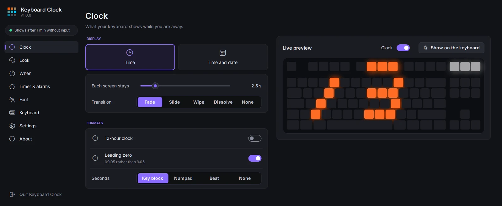
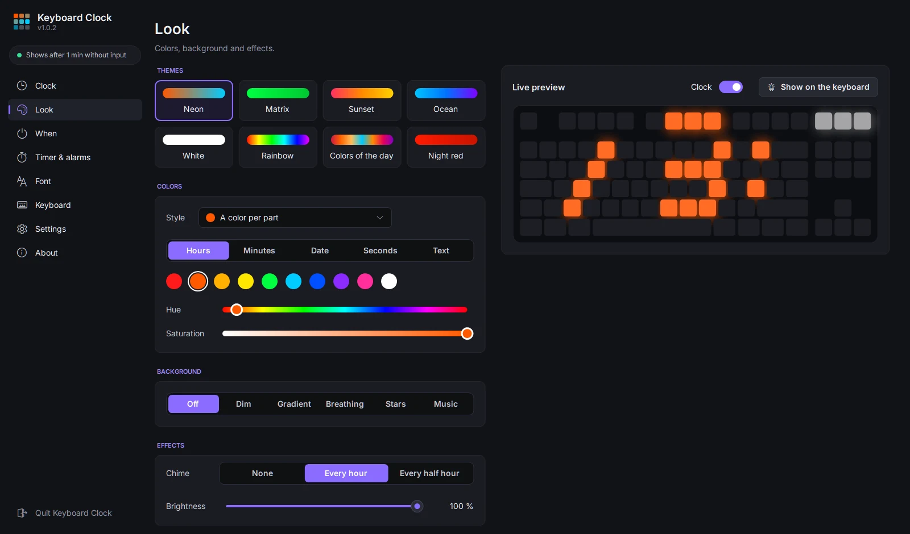
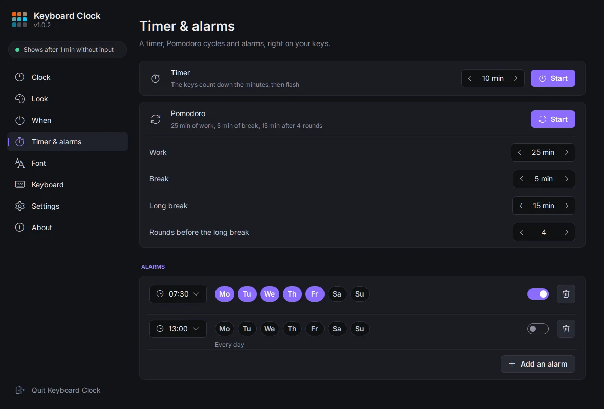
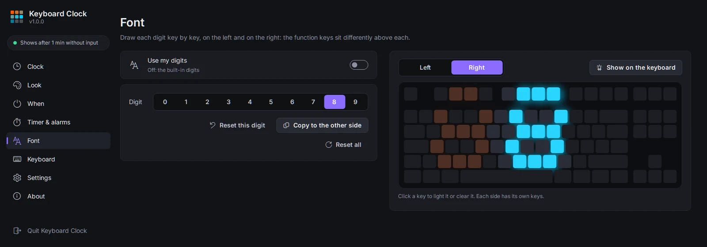

<p align="center">
  
</p>

<h1 align="center">Keyboard Clock</h1>

<p align="center">
  <b>The time, in big digits, on your RGB keyboard.</b><br>
  A free, open-source Windows app for Logitech G, Razer, Corsair, ASUS, SteelSeries, HyperX and OpenRGB keyboards.
</p>

<p align="center">
  <a href="https://github.com/Ilyomix/keyboard-clock/releases/latest"></a>
  <a href="https://github.com/Ilyomix/keyboard-clock/releases"></a>
  <a href="https://github.com/Ilyomix/keyboard-clock/actions/workflows/ci.yml"></a>
  
  <a href="LICENSE"></a>
</p>

<p align="center">
  <a href="https://apps.microsoft.com/detail/9N5M0SCJNPZ3"></a>
</p>

<p align="center">
  <a href="https://github.com/Ilyomix/keyboard-clock/releases/latest/download/KeyboardClockSetup.exe"><b>⬇ Download for Windows</b></a>
  &nbsp;·&nbsp; <a href="https://ilyomix.github.io/keyboard-clock/"><b>Website and live demo</b></a>
</p>

<p align="center">
  <b>English</b> · <a href="README.fr.md">Français</a> · <a href="README.es.md">Español</a> · <a href="README.de.md">Deutsch</a> · <a href="README.it.md">Italiano</a> · <a href="README.pt.md">Português</a>
</p>

---

Step away from your PC and **Keyboard Clock** turns your keyboard into a clock you can read from across the room.
First the hours, then the minutes (13: then :37), in two big digits drawn key by key
over the F-keys, the number row and the letters, one digit on each half of the keyboard. The seconds fill the nine keys above the arrows. Touch the mouse or
any key and your usual lighting is back at once.

It also runs a **timer**, **Pomodoro** cycles and **alarms** right on the keys, lights up with your **music**, and
lets you **draw your own digits**.

## Features

- **Big, readable digits**: two digits at a time, hand-drawn for real keycaps, on TKL and full-size keyboards.
- **Shows up when you leave**: after a delay you pick (10 seconds to 30 minutes), the moment you lock the PC
  (Win+L), all the time, or on a global shortcut (Ctrl+Alt+H by default).
- **Stays out of the way**: hidden while a game or a video is full screen, or while apps you choose are running.
  Switches the keyboard off after a while if you like.
- **Themes and colors**: Neon, Sunset, Ocean, Matrix, Rainbow, White, Night red, colors that follow the time of
  day, or your own colors per element, gradients and per-digit colors.
- **Backgrounds**: off, a dim color, a gradient, breathing, twinkling stars, or **reacting to the music** your PC
  plays (pulse or spectrum).
- **Transitions**: fade, slide, wipe, dissolve or none, and the date in between if you want it.
- **Timer and Pomodoro**: start them from the taskbar icon. The keyboard shows the minutes left, then flashes when
  time is up. Work and breaks get their own colors.
- **Alarms and reminders**: a time and days of the week; the whole keyboard flashes until you press a key.
- **Font editor**: click keys to redraw any digit, left side and right side, with a live preview.
- **Night mode and hourly chime**: dim, red or off at night; a wave of light sweeps the keys on the hour.
- **A real app**: an icon next to the clock with a quick panel, a window with a live preview of your keyboard,
  six languages, starts with Windows, updates in one click.

## Screenshots

<p align="center">
  
</p>

| Look | Timer and alarms | Font editor |
|---|---|---|
|  |  |  |

## Install

1. Get Keyboard Clock from the **[Microsoft Store](https://apps.microsoft.com/detail/9N5M0SCJNPZ3)**: Windows installs it and keeps it up to date. Or download **[KeyboardClockSetup.exe](https://github.com/Ilyomix/keyboard-clock/releases/latest/download/KeyboardClockSetup.exe)**
   (Windows 10 or 11, 64-bit, no admin rights needed).
2. With the installer: run it. If Windows SmartScreen warns you, click **More info**, then **Run anyway**: the app is new, so Microsoft
   doesn't know it yet.
3. Keep your lighting software running:
   - **Logitech G**: open G HUB, *Settings*, and turn on **Allow games & applications to control my lighting**.
   - **Windows Dynamic Lighting**: in *Settings > Personalization > Dynamic Lighting*, switch Dynamic Lighting off
     for that keyboard, so Keyboard Clock and Windows don't both drive the keys.
   - **OpenRGB**: start OpenRGB with its SDK server on (*SDK Server* tab, *Start Server*).

Other downloads, all in the [latest release](https://github.com/Ilyomix/keyboard-clock/releases/latest):

| File | What it is |
|---|---|
| `KeyboardClockSetup.exe` | The installer (Start menu, starts with Windows, clean uninstall) |
| `KeyboardClockPortable.exe` | One file, nothing installed |
| `keyboard-clock.exe` | Command line, for scripts |
| `keyboard_clock.py` | The whole app in one Python file (Python 3.9+, no dependencies) |
| `SHA256SUMS.txt` | Checksums of every file |

Every release is built by [GitHub Actions](.github/workflows/release.yml) from this source code, tested (install
and uninstall included) and published with SHA-256 checksums.

> **Code signing**: Keyboard Clock is applying for [SignPath Foundation](https://signpath.org/)'s free code signing for open source; the Windows files will be signed through it once the project is accepted. Until then Windows SmartScreen may warn about an unknown publisher: click *More info → Run anyway*. [Code signing policy](CODE_SIGNING.md) · [Privacy policy](PRIVACY.md)

## Which keyboards work?

Any keyboard with **per-key RGB** that one of these can drive. Keys are found by their position, so the layout
doesn't matter: AZERTY, QWERTY, QWERTZ, ISO or ANSI.

| | Through | Status |
|---|---|---|
| **Logitech G** (G PRO, G PRO X, G915, G815, G513, G512…) | G HUB's LED SDK | Tested on a G PRO TKL |
| **Razer, Corsair, ASUS ROG, SteelSeries, HyperX, Logitech** and others | Windows Dynamic Lighting (HID LampArray) | Beta |
| Keyboards supported by **OpenRGB** | OpenRGB's SDK server | Beta |

Not supported: keyboards lit by zones or rows only, 60% and 65% keyboards (no row of F-keys to draw on), macOS
and Linux. Your keyboard works, or doesn't? [Tell me in an issue](https://github.com/Ilyomix/keyboard-clock/issues/new/choose):
it helps everyone with the same model.

## FAQ

**How do I show the time on my RGB keyboard?**
Install Keyboard Clock and leave your PC alone for a minute: the time appears on the keys in big digits. You can
also show it as soon as you lock the PC, all the time, or with a keyboard shortcut.

**Nothing shows on my Logitech keyboard.**
In G HUB, *Settings*, turn on *Allow games & applications to control my lighting*, and keep G HUB running. Then
click *Show on the keyboard* in Keyboard Clock's window.

**Does it work with Razer Synapse, Corsair iCUE or SteelSeries GG?**
Through Windows instead: for these brands, Keyboard Clock uses Windows Dynamic Lighting (Windows 11) or OpenRGB.
If your keyboard is listed in *Settings > Personalization > Dynamic Lighting*, it can show the clock.

**Will it slow down my games?**
No. It stays hidden while a game is full screen, and drawing a frame takes a fraction of a millisecond.

**Does it change my lighting for good?**
No. As soon as you touch the mouse or the keyboard, your usual lighting comes back.

**Does it collect data?**
No account, no ads, no telemetry. It only checks GitHub for a new version once a day, which you can turn off. See
the [privacy policy](PRIVACY.md).

## Command line

```bash
keyboard-clock --demo                 # every look on the keyboard, then exit
keyboard-clock --theme sunset --delay 10
keyboard-clock --stop                 # stop the clock running in the background
keyboard-clock --help                 # all the options
```

## Build from source

```bash
git clone https://github.com/Ilyomix/keyboard-clock
cd keyboard-clock
python keyboard_clock.py              # run the app (Python 3.9+, Windows, no dependencies)
python -m unittest discover tests     # the tests
pip install pyinstaller && pyinstaller --onefile --noconsole --name KeyboardClock keyboard_clock.py
```

The website, the README pictures and the screenshots are generated from the app itself by
[`tools/build.py`](tools/build.py).

## How it works

Keyboard Clock is one Python file using only the standard library and `ctypes`. Every frame is drawn in layers
(background, digits, seconds, effects, brightness and night mode, gamma correction), then sent to the keyboard:

- **Logitech**: through the LED SDK that G HUB installs, key by key.
- **Windows Dynamic Lighting**: straight to the keyboard over HID LampArray, the standard behind Dynamic Lighting,
  using each lamp's key binding to find the keys.
- **OpenRGB**: through its SDK server on your PC, matching LED names to keys.

When it stops, it hands the lighting back to your software.

## Also by me

[**Glowback**](https://github.com/Ilyomix/glowback): ambient light for the RGB LEDs behind your monitor, synced to
your screen in real time.

## License

[MIT](LICENSE). Logitech, Logitech G and G HUB are trademarks of Logitech. Razer, Corsair, ASUS, SteelSeries,
HyperX and Windows are trademarks of their respective owners. Keyboard Clock is an independent project, not
affiliated with or endorsed by any of them. The window uses the Inter font (SIL Open Font License,
[licenses/Inter-OFL.txt](licenses/Inter-OFL.txt)).
