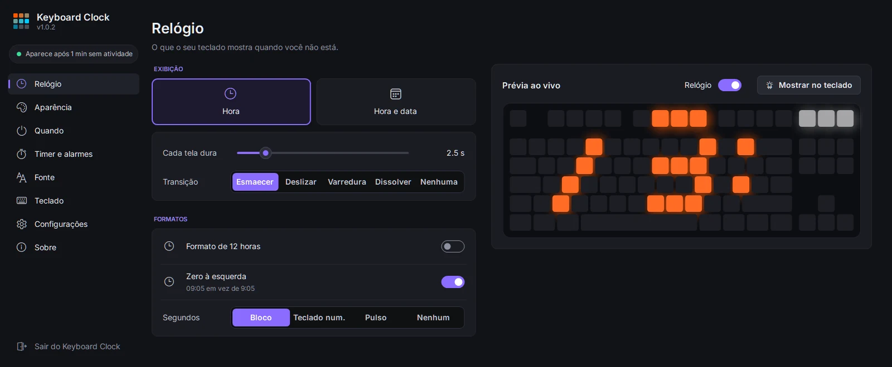
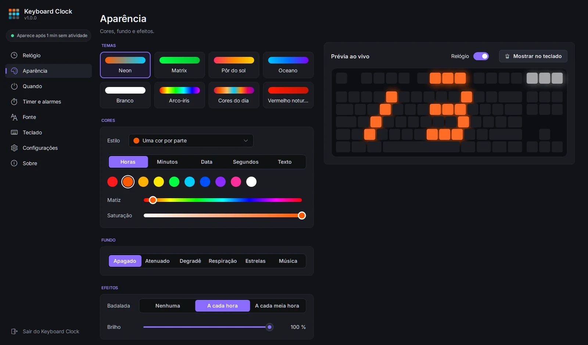
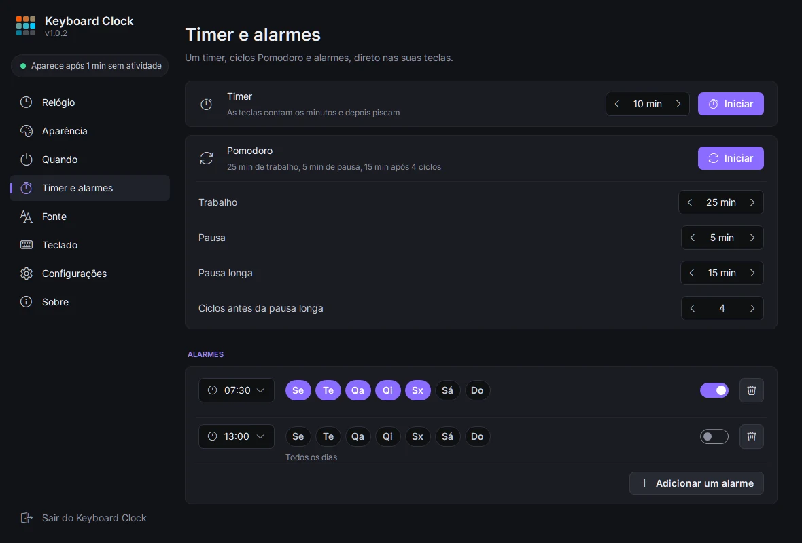
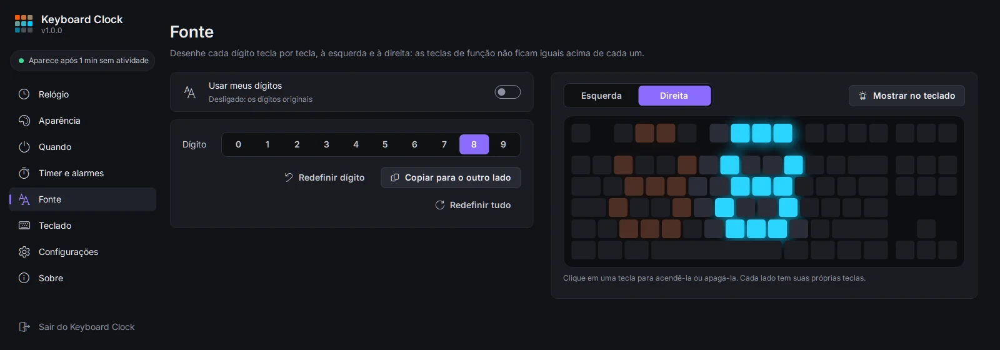

<p align="center">
  
</p>

<h1 align="center">Keyboard Clock</h1>

<p align="center">
  <b>A hora em dígitos grandes no seu teclado RGB.</b><br>
  Um app gratuito e de código aberto para Windows, para teclados Logitech G, Razer, Corsair, ASUS, SteelSeries, HyperX e OpenRGB.
</p>

<p align="center">
  <a href="https://github.com/Ilyomix/keyboard-clock/releases/latest"></a>
  <a href="https://github.com/Ilyomix/keyboard-clock/releases"></a>
  <a href="https://github.com/Ilyomix/keyboard-clock/actions/workflows/ci.yml"></a>
  
  <a href="LICENSE"></a>
</p>

<p align="center">
  <a href="https://apps.microsoft.com/detail/9N5M0SCJNPZ3"></a>
</p>

<p align="center">
  <a href="https://github.com/Ilyomix/keyboard-clock/releases/latest/download/KeyboardClockSetup.exe"><b>⬇ Baixar para Windows</b></a>
  &nbsp;·&nbsp; <a href="https://ilyomix.github.io/keyboard-clock/pt/"><b>Site e demonstração ao vivo</b></a>
</p>

<p align="center">
  <a href="README.md">English</a> · <a href="README.fr.md">Français</a> · <a href="README.es.md">Español</a> · <a href="README.de.md">Deutsch</a> · <a href="README.it.md">Italiano</a> · <b>Português</b>
</p>

---

Quando você sai de perto do PC, o **Keyboard Clock** transforma o seu teclado em um relógio que dá para ler do outro
lado do quarto. Primeiro as horas, depois os minutos, em dois dígitos grandes
desenhados tecla por tecla sobre as teclas de função, a fileira de números e as letras, um dígito em cada metade do teclado. Os segundos preenchem as nove
teclas acima das setas. Toque no mouse ou em qualquer tecla e a sua iluminação de sempre volta na hora.

Ele também roda um **timer**, ciclos **Pomodoro** e **alarmes** direto nas teclas, acende com a sua **música** e
permite que você **desenhe os seus próprios dígitos**.

## Recursos

- **Dígitos grandes e legíveis**: dois dígitos por vez, desenhados à mão para teclas de verdade, em teclados TKL e de
  tamanho completo.
- **Aparece quando você sai**: depois de um tempo que você escolhe (de 10 segundos a 30 minutos), assim que você
  bloqueia o PC (Win+L), o tempo todo ou com um atalho global (Ctrl+Alt+H por padrão).
- **Não atrapalha**: fica oculto enquanto um jogo ou um vídeo está em tela cheia, ou enquanto os apps que você escolher
  estão abertos. Se você quiser, apaga o teclado depois de um tempo.
- **Temas e cores**: Neon, Pôr do sol, Oceano, Matrix, Arco-íris, Branco, Vermelho noturno, cores que acompanham a hora
  do dia, ou as suas próprias cores para cada elemento, degradês e uma cor por dígito.
- **Fundos**: apagado, uma cor atenuada, um degradê, respiração, estrelas piscando ou **reagindo à música** que toca no
  seu PC (pulso ou espectro).
- **Transições**: esmaecer, deslizar, varredura, dissolver ou nenhuma, e a data entre uma hora e outra, se você quiser.
- **Timer e Pomodoro**: inicie pelo ícone na barra de tarefas. O teclado mostra os minutos que faltam e pisca quando o
  tempo acaba. Trabalho e pausas têm cores próprias.
- **Alarmes e lembretes**: um horário e os dias da semana; o teclado inteiro pisca até você apertar uma tecla.
- **Editor de fonte**: clique nas teclas para redesenhar qualquer dígito, do lado esquerdo e do lado direito, com prévia
  ao vivo.
- **Modo noturno e badalada de hora em hora**: atenuado, em vermelho ou apagado à noite; na hora cheia, uma onda de luz
  atravessa as teclas.
- **Um app de verdade**: um ícone ao lado do relógio com um painel rápido, uma janela com prévia ao vivo do seu teclado,
  seis idiomas, inicia com o Windows e se atualiza com um clique.

## Capturas de tela

<p align="center">
  
</p>

| Aparência | Timer e alarmes | Editor de fonte |
|---|---|---|
|  |  |  |

## Instalação

1. Instale o Keyboard Clock pela **[Microsoft Store](https://apps.microsoft.com/detail/9N5M0SCJNPZ3)**: o Windows instala e mantém atualizado. Ou baixe o **[KeyboardClockSetup.exe](https://github.com/Ilyomix/keyboard-clock/releases/latest/download/KeyboardClockSetup.exe)**
   (Windows 10 ou 11, 64 bits, sem precisar de privilégios de administrador).
2. Com o instalador: execute. Se o Windows SmartScreen exibir um aviso, clique em **Mais informações** e depois em **Executar assim
   mesmo**: o app é novo, então a Microsoft ainda não o conhece.
3. Deixe o seu software de iluminação aberto:
   - **Logitech G**: abra o G HUB, vá em *Configurações* e ative **“Allow games & applications to control my lighting”**.
   - **Iluminação dinâmica do Windows**: em *Configurações > Personalização > Iluminação dinâmica*, desative a
     Iluminação dinâmica para esse teclado, para que o Keyboard Clock e o Windows não controlem as teclas ao mesmo
     tempo.
   - **OpenRGB**: abra o OpenRGB com o servidor SDK ligado (aba *SDK Server*, *Start Server*).

Outros downloads, todos na [versão mais recente](https://github.com/Ilyomix/keyboard-clock/releases/latest):

| Arquivo | O que é |
|---|---|
| `KeyboardClockSetup.exe` | O instalador (menu Iniciar, inicia com o Windows, desinstalação limpa) |
| `KeyboardClockPortable.exe` | Um só arquivo, nada é instalado |
| `keyboard-clock.exe` | Linha de comando, para scripts |
| `keyboard_clock.py` | O app inteiro em um único arquivo Python (Python 3.9+, sem dependências) |
| `SHA256SUMS.txt` | Somas de verificação de todos os arquivos |

Cada versão é compilada pelo [GitHub Actions](.github/workflows/release.yml) a partir deste código-fonte, testada
(incluindo instalação e desinstalação) e publicada com somas de verificação SHA-256.

> **Assinatura de código**: o Keyboard Clock está solicitando a assinatura de código gratuita da [SignPath Foundation](https://signpath.org/) para projetos de código aberto; os arquivos do Windows serão assinados por ela assim que o projeto for aceito. Até lá, o Windows SmartScreen pode avisar sobre um editor desconhecido: clique em *Mais informações → Executar assim mesmo*. [Política de assinatura de código](CODE_SIGNING.md) · [Privacidade](PRIVACY.md)

## Quais teclados funcionam?

Qualquer teclado com **RGB por tecla** que um destes consiga controlar. As teclas são encontradas pela posição, então o
layout não importa: AZERTY, QWERTY, QWERTZ, ISO ou ANSI.

| | Por meio de | Status |
|---|---|---|
| **Logitech G** (G PRO, G PRO X, G915, G815, G513, G512…) | LED SDK do G HUB | Testado em um G PRO TKL |
| **Razer, Corsair, ASUS ROG, SteelSeries, HyperX, Logitech** e outros | Iluminação dinâmica do Windows (HID LampArray) | Beta |
| Teclados compatíveis com o **OpenRGB** | Servidor SDK do OpenRGB | Beta |

Não compatíveis: teclados com iluminação só por zonas ou por fileiras, teclados 60% e 65% (sem a fileira de teclas de
função para desenhar), macOS e Linux. O seu teclado funciona, ou não? [Conte em uma issue](https://github.com/Ilyomix/keyboard-clock/issues/new/choose):
isso ajuda todo mundo que tem o mesmo modelo.

## Perguntas frequentes

**Como mostrar a hora no meu teclado RGB?**
Instale o Keyboard Clock e deixe o PC parado por um minuto: a hora aparece nas teclas em dígitos grandes. Ela também
pode aparecer assim que você bloquear o PC, o tempo todo ou com um atalho de teclado.

**Nada aparece no meu teclado Logitech.**
No G HUB, em *Configurações*, ative *“Allow games & applications to control my lighting”* e deixe o G HUB aberto.
Depois, na janela do Keyboard Clock, clique em *Mostrar no teclado*.

**Funciona com Razer Synapse, Corsair iCUE ou SteelSeries GG?**
Funciona pelo Windows, e não por esses programas: para essas marcas, o Keyboard Clock usa a Iluminação dinâmica do
Windows (Windows 11) ou o OpenRGB. Se o seu teclado estiver na lista em *Configurações > Personalização > Iluminação
dinâmica*, ele pode mostrar o relógio.

**Ele deixa os meus jogos mais lentos?**
Não. Ele fica oculto enquanto um jogo está em tela cheia, e desenhar um quadro leva uma fração de milissegundo.

**Ele muda a minha iluminação para sempre?**
Não. Assim que você toca no mouse ou no teclado, a sua iluminação de sempre volta.

**Ele coleta dados?**
Sem cadastro, sem anúncios, sem telemetria. Ele só procura uma nova versão no GitHub uma vez por dia, e você pode
desativar isso. Veja a [política de privacidade](PRIVACY.md).

## Linha de comando

```bash
keyboard-clock --demo                 # every look on the keyboard, then exit
keyboard-clock --theme sunset --delay 10
keyboard-clock --stop                 # stop the clock running in the background
keyboard-clock --help                 # all the options
```

## Compilar a partir do código-fonte

```bash
git clone https://github.com/Ilyomix/keyboard-clock
cd keyboard-clock
python keyboard_clock.py              # run the app (Python 3.9+, Windows, no dependencies)
python -m unittest discover tests     # the tests
pip install pyinstaller && pyinstaller --onefile --noconsole --name KeyboardClock keyboard_clock.py
```

O site, as imagens do README e as capturas de tela são gerados a partir do próprio app pelo
[`tools/build.py`](tools/build.py).

## Como funciona

O Keyboard Clock é um único arquivo Python que usa apenas a biblioteca padrão e o `ctypes`. Cada quadro é desenhado em
camadas (fundo, dígitos, segundos, efeitos, brilho e modo noturno, correção de gama) e depois enviado ao teclado:

- **Logitech**: pelo LED SDK que o G HUB instala, tecla por tecla.
- **Iluminação dinâmica do Windows**: direto para o teclado via HID LampArray, o padrão por trás da Iluminação
  dinâmica, usando a tecla associada a cada lâmpada para encontrar as teclas.
- **OpenRGB**: pelo servidor SDK dele no seu PC, associando os nomes dos LEDs às teclas.

Quando para, ele devolve a iluminação para o seu software.

## Outros projetos meus

[**Glowback**](https://github.com/Ilyomix/glowback): luz ambiente para os LEDs RGB atrás do seu monitor, sincronizada
com a tela em tempo real.

## Licença

[MIT](LICENSE). Logitech, Logitech G e G HUB são marcas comerciais da Logitech. Razer, Corsair, ASUS, SteelSeries,
HyperX e Windows são marcas comerciais de seus respectivos proprietários. O Keyboard Clock é um projeto independente,
não afiliado a nenhuma delas nem endossado por elas. A janela usa a fonte Inter (SIL Open Font License,
[licenses/Inter-OFL.txt](licenses/Inter-OFL.txt)).
